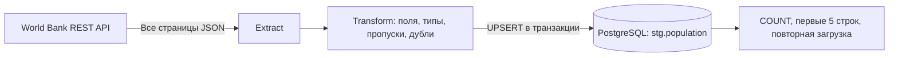

# ДЗ №1. Население стран: REST API → PostgreSQL

Пайплайн получает население десяти стран из API Всемирного банка, приводит JSON к таблице и записывает результат в PostgreSQL. Запуск выполняется из [notebooks/etl.ipynb](notebooks/etl.ipynb). Повторная загрузка обновляет изменившиеся наблюдения и не создаёт дубли.

## Источник

Используется **World Bank Indicators API v2**, показатель `SP.POP.TOTL` — общая численность населения. Это REST API, который отдаёт JSON и [не требует ключа](https://datahelpdesk.worldbank.org/knowledgebase/articles/889392). Данные подходят для первого ETL: у наблюдения есть понятный ключ «страна + год», вложенные поля нужно распаковать, а ответы приходят по страницам.

Выборка: Бразилия, Китай, Индия, ЮАР, Россия, США, Германия, Франция, Япония и Великобритания (`BRA, CHN, IND, ZAF, RUS, USA, DEU, FRA, JPN, GBR`), **2000–2024 годы включительно**. Это до **250 наблюдений**: 10 стран × 25 лет. При размере страницы 50 ожидается пять страниц. Если источник возвращает `null` вместо населения, запись пропускается; фактическое количество показывает ноутбук. Выбор стран нужен для небольшой разнообразной учебной выборки, а не для статистических выводов о мире.

Endpoint:

```text
https://api.worldbank.org/v2/country/BRA;CHN;IND;ZAF;RUS;USA;DEU;FRA;JPN;GBR/indicator/SP.POP.TOTL
```

Параметры: `format=json`, `source=2`, `date=2000:2024`, `per_page=50`, `page=1…pages`.
[Описание параметров и пагинации](https://datahelpdesk.worldbank.org/knowledgebase/articles/898581-api-basic-call-structures).

Ответ — массив из метаданных и списка наблюдений. Ниже метаданные первой страницы и одно наблюдение из ответа, полученного при проверке:

```json
[
  {"page": 1, "pages": 5, "per_page": 50, "total": 250, "sourceid": "2", "lastupdated": "2026-11-11"},
  [
    {
      "indicator": {"id": "SP.POP.TOTL", "value": "Population, total"},
      "country": {"id": "BR", "value": "Brazil"},
      "countryiso3code": "BRA",
      "date": "2024",
      "value": 211998573,
      "unit": "",
      "obs_status": "",
      "decimal": 0
    }
  ]
]
```

| Поле источника | Тип JSON | Значение |
| --- | --- | --- |
| `indicator.id` | string | Код показателя |
| `indicator.value` | string | Название показателя |
| `country.id` | string | Двухбуквенный код страны |
| `country.value` | string | Название страны |
| `countryiso3code` | string | Трёхбуквенный код страны |
| `date` | string | Год наблюдения |
| `value` | number или null | Население в людях |
| `unit` | string | Единица измерения; для этого показателя обычно пустая |
| `obs_status` | string | Статус наблюдения |
| `decimal` | integer | Число знаков для отображения |
| `lastupdated` в метаданных | string, YYYY-MM-DD | Дата обновления набора источника |

Названия, численность и дата обновления могут меняться при пересмотре данных Всемирным банком. `lastupdated` относится к набору источника, а не к отдельной стране.

## Целевая таблица

[init/init.sql](init/init.sql) создаёт схему `stg` и таблицу `stg.population`.

| Поле | Тип PostgreSQL | Назначение |
| --- | --- | --- |
| `country_code` | CHAR(3), NOT NULL | ISO3-код страны |
| `country_name` | TEXT, NOT NULL | Название страны без пробелов по краям |
| `year` | SMALLINT, NOT NULL | Год от 1900 до 2100 |
| `population` | BIGINT, NOT NULL | Целое неотрицательное население |
| `indicator_code` | TEXT, NOT NULL | Только `SP.POP.TOTL` |
| `source_updated_at` | DATE, NOT NULL | Дата обновления набора API |
| `loaded_at` | TIMESTAMPTZ, NOT NULL | Время вставки или последнего изменения строки |

Первичный ключ — **(`country_code`, `year`)**. Числовые значения передаются в SQL параметрами. Загрузка проходит одной транзакцией: ошибка отменяет весь пакет.

## Как устроен пайплайн



1. **Extract:** GET-запросы с таймаутом, до трёх повторов после первого запроса при сетевых сбоях, HTTP 429 и 5xx. Номера страниц, количество строк и дата версии проверяются. Неполный ответ не попадает в БД.
2. **Transform:** распаковка вложенного JSON, переименование полей, удаление наблюдений без населения и точных дублей, приведение года и населения к целым числам. Некорректные значения и противоречивые записи с одинаковым ключом останавливают пайплайн.
3. **Load:** `INSERT … ON CONFLICT … DO UPDATE`. Пересмотренные значения обновляются; одинаковые строки не меняются, включая `loaded_at`.
4. **Проверка:** SQL `COUNT(*)`, первые пять строк и отсутствие дублей. Пакет загружается ещё раз, затем сравнивается всё содержимое таблицы, включая время загрузки.

Логи каждого этапа выводятся в ноутбук и сохраняются в `logs/etl.log`. Пароль в лог не записывается. Функции ETL находятся в [etl.py](etl.py).

## Запуск с нуля

Нужны **Python 3.12+**, **Docker Engine / Docker Desktop** и **Docker Compose v2 или новее**. Для API и установки зависимостей нужен интернет. Порт PostgreSQL по умолчанию — `55432`, чтобы не мешать стенду из занятия.

```bash
git clone https://github.com/Q0un/hse_de.git
cd hse_de/hw-1
bash run.sh
```

[run.sh](run.sh) создаёт `.venv`, устанавливает зависимости, готовит `.env` со случайным паролем, поднимает PostgreSQL и выполняет ноутбук целиком. В конце он выводит `SELECT COUNT(*)`, а результаты ячеек сохраняет в `notebooks/etl.ipynb`. Активировать окружение и вручную создавать `.env` не нужно.

Существующие настройки в `.env` сохраняются. Если там остался шаблонный пароль из `.env.example`, скрипт заменит его случайным; уже заданный пароль не меняется. Параметры API и подключения можно настроить в `.env`, переменные окружения процесса имеют приоритет.

Для повторного запуска достаточно снова выполнить `bash run.sh`. PostgreSQL остаётся запущенным, данные хранятся в именованном volume. Образ зафиксирован как `postgres:16.6-alpine`, порт опубликован только на `127.0.0.1`. SQL инициализации выполняется при первом запуске на пустом volume. Скрипт рассчитан на Bash в Linux, macOS или WSL.

Если хочется поработать с ноутбуком интерактивно, после скрипта запустите Jupyter:

```bash
.venv/bin/python -m jupyterlab notebooks/etl.ipynb
```

Выберите ядро **DE HW1 (.venv)**. Настройки и подключение уже будут готовы.

Дополнительная проверка через SQL:

```bash
docker compose exec postgres sh -c 'psql -U "$POSTGRES_USER" -d "$POSTGRES_DB" -c "SELECT country_code, country_name, year, population FROM stg.population ORDER BY country_code, year LIMIT 5;"'
```

При повторном запуске с неизменным ответом API количество строк и содержимое таблицы останутся прежними. Обычная остановка сохраняет данные:

```bash
docker compose down
```

Если нужно заново применить `init.sql` к существующему volume без удаления данных:

```bash
docker compose exec -T postgres sh -c 'psql -v ON_ERROR_STOP=1 -U "$POSTGRES_USER" -d "$POSTGRES_DB"' < init/init.sql
```

При смене пароля в `.env` существующий пользователь PostgreSQL сам не обновляется: используйте исходный пароль либо измените его в БД. `docker compose down -v` удаляет учебную БД целиком и нужен только для намеренного сброса.

## Результат

Ноутбук выполнен сверху вниз на Linux с Python 3.12.3 и PostgreSQL 16.6 в Docker. Последняя ячейка вывела следующие результаты:

| Проверка | Результат |
| --- | --- |
| Строк после Extract | 250 |
| Строк после Transform | 250 |
| Строк в `stg.population` | 250 |
| Строк после повторной загрузки | 250 |
| Групп с повторяющимся ключом | 0 |
| Содержимое после повторной загрузки | Не изменилось |

Первые пять наблюдений из целевой таблицы:

| country_code | country_name | year | population |
| --- | --- | --- | --- |
| BRA | Brazil | 2000 | 174018282 |
| BRA | Brazil | 2001 | 176301203 |
| BRA | Brazil | 2002 | 178503484 |
| BRA | Brazil | 2003 | 180622688 |
| BRA | Brazil | 2004 | 182675143 |
